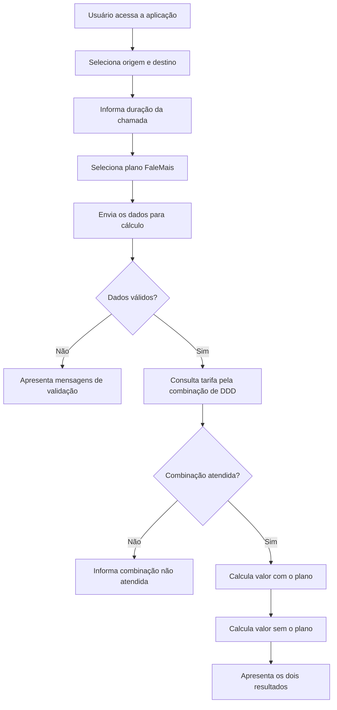
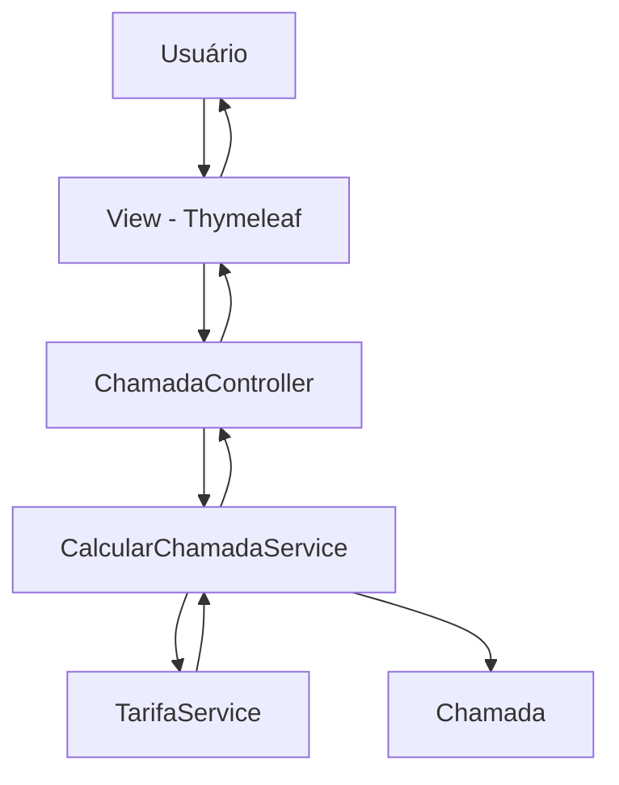

# ☎️ FaleMais — Simulador de Chamadas

**Desafio técnico | Desenvolvedor Java Júnior**

Simule o custo de chamadas telefônicas de longa distância nacional, compare tarifas com e sem planos e descubra quanto você pode economizar com o FaleMais.

---

## 📌 Visão geral

O **FaleMais** é uma aplicação web desenvolvida em Java com Spring Boot e Thymeleaf, criada para solucionar um desafio proposto por uma empresa de telefonia especializada em chamadas de longa distância nacional.

A aplicação permite que o usuário informe:

- DDD de origem;
- DDD de destino;
- Duração da chamada em minutos;
- Plano FaleMais desejado.

Com essas informações, o sistema calcula e apresenta dois resultados:

1. **Valor com FaleMais:** considera os minutos gratuitos do plano e cobra apenas os minutos excedentes, com acréscimo de 10% sobre a tarifa normal.
2. **Valor sem FaleMais:** considera o valor integral da chamada, sem nenhum benefício do plano.

O objetivo é proporcionar transparência ao cliente e permitir que ele compare os custos antes de escolher um plano.

O projeto também tem como objetivo demonstrar a aplicação prática de conceitos fundamentais do desenvolvimento backend com Java e Spring Boot.

---

## 🎯 Contexto do desafio

Uma empresa de telefonia especializada em chamadas de longa distância nacional deseja lançar um novo produto chamado **FaleMais**.

Tradicionalmente, seus clientes pagam uma tarifa fixa por minuto, definida conforme a combinação entre os DDDs de origem e destino da chamada.

Com o lançamento do FaleMais, o cliente poderá contratar um plano que oferece uma quantidade determinada de minutos gratuitos.

Caso a duração da ligação ultrapasse o limite de minutos do plano, somente os minutos excedentes serão cobrados, com um acréscimo de 10% sobre a tarifa normal.

Para facilitar a compreensão dos custos, a empresa deseja disponibilizar uma página web na qual o cliente possa simular suas ligações e comparar os valores.

**Importante:** o custo de aquisição do plano não faz parte deste desafio e, portanto, não deve ser considerado nos cálculos.

---

## 📋 Regras de negócio

Esta seção descreve as regras que orientam o funcionamento da aplicação.

### 1. Tarifas por combinação de DDD

Cada combinação de DDD de origem e destino possui uma tarifa específica por minuto.

| Origem | Destino | Tarifa por minuto |
|---|---|---:|
| 011 | 016 | R$ 1,90 |
| 011 | 017 | R$ 1,70 |
| 016 | 011 | R$ 2,90 |
| 017 | 011 | R$ 2,70 |
| 011 | 018 | R$ 0,90 |
| 018 | 011 | R$ 1,90 |

A tarifa deve ser consultada considerando a combinação exata entre origem e destino.

**Regra:** combinações não cadastradas não são atendidas pelo sistema. Nesse caso, a aplicação deve informar que a combinação de DDD não é suportada, em vez de realizar um cálculo com tarifa zero.

### 2. Planos FaleMais

O cliente pode escolher entre três modalidades:

| Plano | Minutos gratuitos |
|---|---:|
| FaleMais 30 | 30 minutos |
| FaleMais 60 | 60 minutos |
| FaleMais 120 | 120 minutos |

Os minutos gratuitos são utilizados para determinar a quantidade de minutos excedentes que será cobrada.

### 3. Cobrança dos minutos excedentes

Quando a duração da chamada ultrapassar os minutos gratuitos do plano, somente o excedente será cobrado.

Sobre a tarifa normal por minuto é aplicado um acréscimo de 10%.

**Fórmula do cálculo com plano:**

`Valor = minutos excedentes × tarifa por minuto × 1,10`

Os minutos excedentes nunca podem ser negativos.

### 4. Cálculo sem plano

Para calcular o valor da chamada sem o FaleMais, todos os minutos são cobrados pela tarifa normal.

**Fórmula do cálculo sem plano:**

`Valor = duração da chamada × tarifa por minuto`

### 5. Comparação de valores

A aplicação deve apresentar os dois resultados para a mesma chamada:

- Valor com o plano selecionado.
- Valor sem a contratação do plano.

O custo de aquisição do plano deve ser desconsiderado.

---

## 🧮 Exemplos práticos de cálculo

Os exemplos abaixo demonstram como as regras de negócio são aplicadas.

### Exemplo 1 — Ligação dentro dos minutos gratuitos

**Cenário:**

- Origem: 011
- Destino: 016
- Duração: 20 minutos
- Plano: FaleMais 30
- Tarifa normal: R$ 1,90/minuto

**Com FaleMais 30:**

Como a ligação possui 20 minutos e o plano oferece 30 minutos gratuitos, não existem minutos excedentes.

Resultado: **R$ 0,00**

**Sem FaleMais:**

20 × R$ 1,90 = **R$ 38,00**

### Exemplo 2 — Ligação ultrapassa os minutos gratuitos

**Cenário:**

- Origem: 011
- Destino: 016
- Duração: 40 minutos
- Plano: FaleMais 30
- Tarifa normal: R$ 1,90/minuto

**Com FaleMais 30:**

1. Duração total: 40 minutos.
2. Minutos gratuitos: 30 minutos.
3. Minutos excedentes: 10 minutos.
4. Tarifa com acréscimo: R$ 1,90 × 1,10 = R$ 2,09.

10 × R$ 2,09 = **R$ 20,90**

**Sem FaleMais:**

40 × R$ 1,90 = **R$ 76,00**

### Exemplo 3 — Ligação dentro do plano FaleMais 60

**Cenário:**

- Origem: 018
- Destino: 011
- Duração: 60 minutos
- Plano: FaleMais 60
- Tarifa normal: R$ 1,90/minuto

**Com FaleMais 60:**

60 minutos gratuitos. Não existem minutos excedentes.

Resultado: **R$ 0,00**

**Sem FaleMais:**

60 × R$ 1,90 = **R$ 114,00**

---

## 🔄 Fluxo de funcionamento



---

## 🏗️ Arquitetura da aplicação

O projeto utiliza uma organização baseada em camadas, seguindo uma abordagem MVC (Model-View-Controller).

A separação de responsabilidades facilita a manutenção, os testes e a evolução da aplicação.

### Organização das responsabilidades

| Camada | Responsabilidade |
|---|---|
| Controller | Receber as requisições HTTP e controlar o fluxo da aplicação. |
| Service | Executar as regras de negócio e coordenar os cálculos. |
| Model | Representar os dados da chamada e seus resultados. |
| Exception | Centralizar exceções específicas da aplicação. |
| Config | Concentrar configurações da aplicação. |
| View | Apresentar as informações e permitir a interação com o usuário. |

### Diagrama de arquitetura



### Responsabilidade dos principais componentes

**ChamadaController**

Responsável por receber as solicitações do usuário, disponibilizar as páginas de cálculo e encaminhar os dados para o serviço responsável pelo processamento.

**CalcularChamadaService**

Coordena a execução das regras de negócio, valida os dados necessários, consulta as tarifas e calcula os valores com e sem o plano.

**TarifaService**

Centraliza a consulta das tarifas por combinação de DDD, evitando que os valores fiquem espalhados pelo código.

**Chamada**

Representa os dados da ligação, incluindo origem, destino, duração, plano selecionado e resultados financeiros.

**Exceptions**

Representam situações excepcionais da aplicação, como combinações de DDD não atendidas e dados inválidos.

---

## 🧪 Testes automatizados

Os testes automatizados são utilizados para verificar se as regras de negócio estão funcionando conforme o esperado.

O projeto utiliza **JUnit 5**, integrado ao Spring Boot Test.

Entre os cenários contemplados estão:

- Consulta das seis combinações de DDD cadastradas.
- Retorno correto das tarifas.
- Tratamento de combinações de DDD não atendidas.
- Inicialização e testes da aplicação.

### Executando os testes

Na raiz do projeto, execute:

```bash
./mvnw clean test
```

No Windows PowerShell:

```powershell
.\mvnw.cmd clean test
```

O Maven executará os testes e apresentará o resultado no terminal.

---

## 🛠️ Tecnologias utilizadas

| Tecnologia | Finalidade |
|---|---|
| Java 11 | Linguagem de programação |
| Spring Boot 2.4.5 | Framework backend |
| Spring MVC | Controle das requisições HTTP |
| Thymeleaf | Renderização das páginas HTML |
| Bootstrap 4 | Estilização e responsividade |
| JavaScript / jQuery | Interações no frontend |
| Bean Validation | Validação dos dados de entrada |
| Maven | Gerenciamento de dependências e build |
| JUnit 5 | Testes automatizados |
| Git | Controle de versão |

---

## 📁 Estrutura do projeto

Organização lógica das principais partes da aplicação:

```text
src
├── main
│   ├── java
│   │   └── com.teste.boot
│   │       ├── controller
│   │       ├── service
│   │       ├── model
│   │       ├── config
│   │       ├── exception
│   │       └── TestePraticoApplication.java
│   │
│   └── resources
│       ├── static
│       │   ├── css
│       │   ├── js
│       │   └── images
│       │
│       ├── templates
│       │   ├── fragments
│       │   ├── chamadas
│       │   └── home.html
│       │
│       └── application.properties
│
└── test
    └── java
        └── com.teste.boot
            ├── TarifaServiceTests.java
            └── TestePraticoApplicationTests.java
```

## ⚙️ Como executar o projeto

### Pré-requisitos

- JDK 11 instalado.
- Git instalado.
- IDE de sua preferência, como IntelliJ IDEA ou Spring Tools 4.
- Maven Wrapper incluído no projeto.

### 1. Clonar o repositório

```bash
git clone <URL_DO_REPOSITORIO>
```

### 2. Entrar na pasta do projeto

```bash
cd DevJunior
```

### 3. Executar a aplicação

No Windows PowerShell:

```powershell
.\mvnw.cmd spring-boot:run
```

Em ambientes Linux ou macOS:

```bash
./mvnw spring-boot:run
```

Também é possível importar o projeto em uma IDE compatível com Maven e executar a classe principal:

`TestePraticoApplication.java`

### 4. Acessar a aplicação

Após a inicialização, acesse:

http://localhost:8080

A aplicação utiliza a porta 8080 por padrão.

---

## 🎯 Objetivos técnicos do desafio

O projeto permite demonstrar conhecimentos fundamentais esperados de um desenvolvedor Java Júnior:

- Programação orientada a objetos.
- Manipulação de tipos numéricos e valores monetários.
- Estruturas condicionais e regras de negócio.
- Desenvolvimento de aplicações web com Spring Boot.
- Criação de endpoints e controle de requisições HTTP.
- Separação de responsabilidades em camadas.
- Injeção de dependências.
- Validação de dados.
- Tratamento de exceções.
- Testes unitários com JUnit 5.
- Gerenciamento de dependências com Maven.
- Versionamento com Git.

---

## 🔮 Possíveis evoluções

Como oportunidades de evolução do projeto, podem ser consideradas:

- Persistência de tarifas em banco de dados.
- Administração das tarifas e planos por interface web.
- Cadastro de novos planos FaleMais.
- Criação de uma API REST para disponibilizar os cálculos.
- Documentação dos endpoints com OpenAPI/Swagger.
- Ampliação da cobertura de testes unitários e de integração.
- Testes automatizados de interface.

Essas funcionalidades representam possibilidades futuras e não fazem parte das regras originais do desafio.

---

## 📌 Considerações finais

O FaleMais nasceu de um desafio técnico voltado à avaliação de conhecimentos de desenvolvimento Java.

Embora a regra central seja relativamente simples, sua implementação permite trabalhar conceitos importantes de engenharia de software: interpretação de requisitos, modelagem de regras de negócio, separação de responsabilidades, validação, tratamento de exceções e testes automatizados.

A proposta é manter a solução simples, compreensível e adequada ao nível de um desenvolvedor Java Júnior, sem deixar de aplicar boas práticas de desenvolvimento.

**Mais do que realizar um cálculo, o objetivo é demonstrar como transformar um problema de negócio em uma solução de software organizada, testável e de fácil manutenção.**
